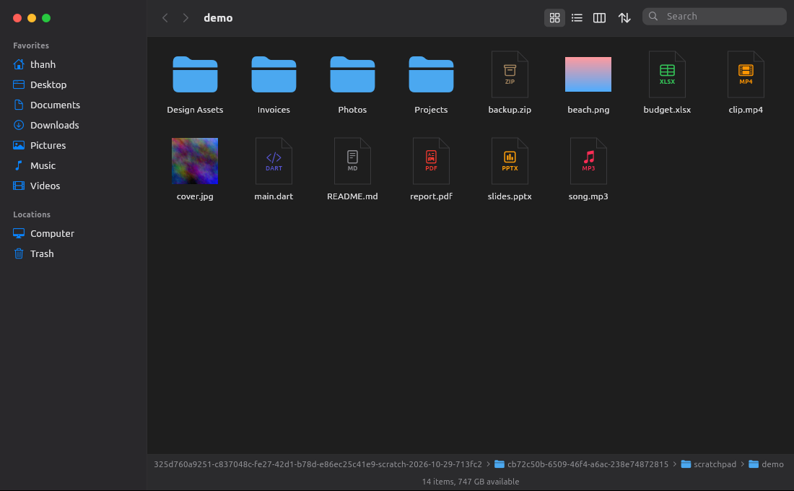
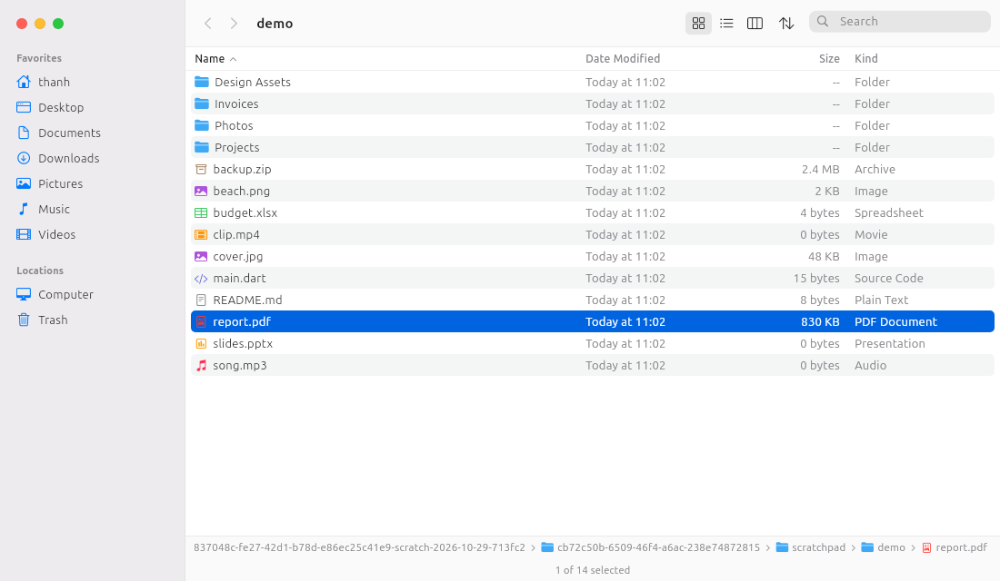
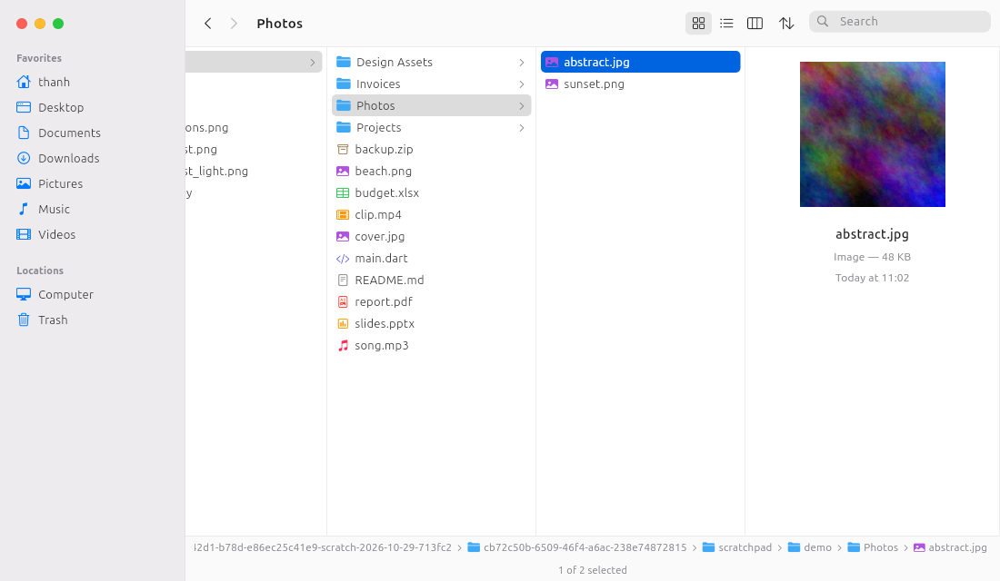
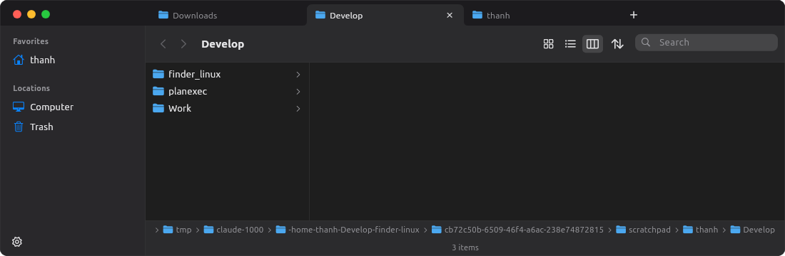
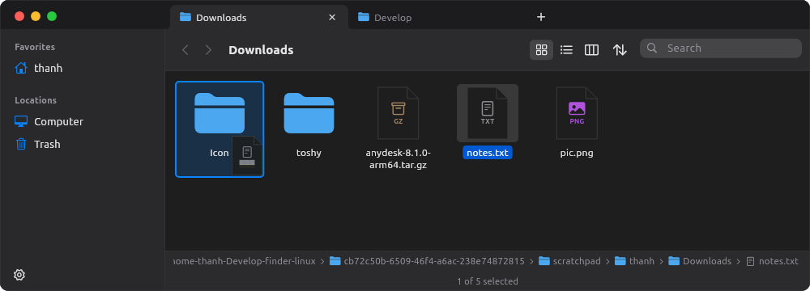
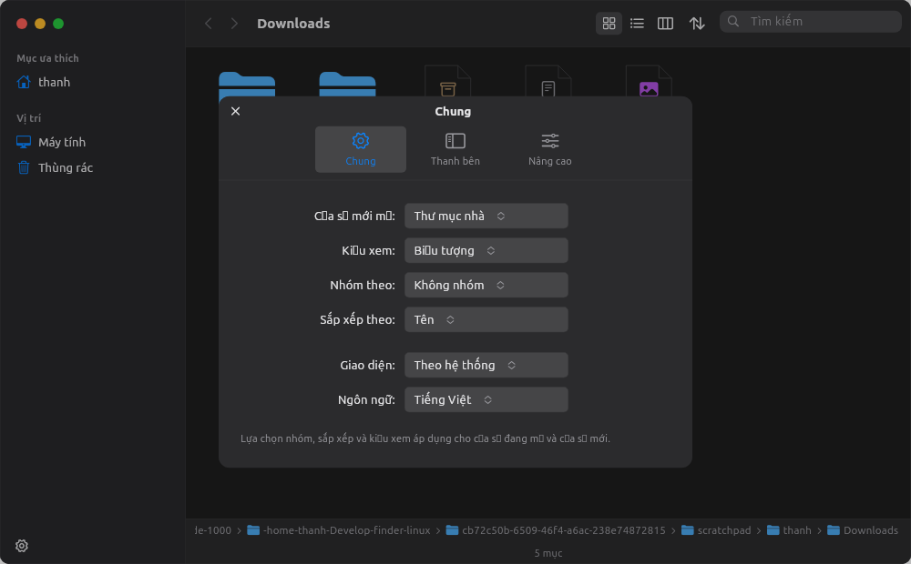

# Finder for Ubuntu

Trình quản lý file phong cách macOS Finder cho Ubuntu (GNOME), viết bằng Flutter Linux desktop.

| Icons | List | Columns |
|---|---|---|
|  |  |  |

## Tính năng

- **3 chế độ xem**: Icons (thumbnail ảnh), List (cột sắp xếp được), Columns (Miller columns + preview).
  Mở một mục ở sidebar thì Column view bắt đầu từ chính thư mục đó.
- **Group By** (Loại / Ngày sửa đổi / Kích thước) và sắp xếp, áp dụng cho cả cửa sổ, kể cả từng cột.
- **Tab kiểu Chrome**: kéo đổi thứ tự, click chuột giữa để đóng, menu chuột phải; mỗi tab có lịch sử riêng.
  **Gộp tất cả cửa sổ** thành một cửa sổ nhiều tab (Ctrl+Shift+M).
- **Kéo-thả file** vào thư mục, cột, sidebar, path bar hoặc tab khác (giữ trên tab để mở nó);
  giữ Ctrl khi thả để sao chép, thả vào Thùng rác để xóa.
- **Settings** (Ctrl+,): thư mục mở mặc định, mở thư mục trong tab thay vì cửa sổ mới, kiểu xem,
  nhóm/sắp xếp, ngôn ngữ; **Hiển thị**: sáng/tối, màu nhấn (8 màu macOS), cỡ chữ, cỡ biểu tượng,
  hiện path bar / thanh trạng thái / phần mở rộng tên tệp; mục trên sidebar; tệp ẩn, thumbnail,
  cảnh báo dọn Thùng rác, Enter để đổi tên kiểu macOS.
- **Sidebar** đọc thư mục XDG và bookmarks GTK (dùng chung với Nautilus); ổ USB kèm nút Eject;
  Trash chuẩn freedesktop (Put Back, Empty Trash).
- **Thao tác file**: New Folder, Rename tại chỗ, Copy/Cut/Paste, Duplicate, Move to Trash,
  Get Info, Copy Path, Open in Terminal, Add to Sidebar, **Quick Look** (Space).
- Cửa sổ bo góc kiểu macOS với traffic lights; theo light/dark của hệ thống; tiếng Anh và tiếng Việt.

| Tabs | Kéo-thả | Settings |
|---|---|---|
|  |  |  |

## Phím tắt (Cmd của macOS → Ctrl)

| Phím | Hành động | Phím | Hành động |
|---|---|---|---|
| Enter / Ctrl+↓ | Mở | Alt+← / Ctrl+[ | Back |
| F2 | Đổi tên | Alt+→ / Ctrl+] | Forward |
| Space | Quick Look | Alt+↑ / Ctrl+↑ | Thư mục cha |
| Delete / Ctrl+Backspace | Move to Trash | Ctrl+1 / 2 / 3 | Icons / List / Columns |
| Ctrl+C / X / V | Copy / Cut / Paste | Ctrl+H, Ctrl+Shift+. | Hiện/ẩn file ẩn |
| Ctrl+D | Duplicate | Ctrl+F | Tìm kiếm |
| Ctrl+I | Get Info | Ctrl+L, Ctrl+Shift+G | Go to Folder |
| Ctrl+Alt+C | Copy Path | Ctrl+Shift+N | New Folder |
| Ctrl+Shift+H / D / O / L | Home / Desktop / Documents / Downloads | Ctrl+N / Ctrl+Q | Cửa sổ mới / Đóng cửa sổ |
| Ctrl+T / Ctrl+W | Tab mới / Đóng tab | Ctrl+Tab, Alt+1…9 | Chuyển tab |
| Ctrl+Shift+M | Gộp tất cả cửa sổ | Ctrl+, | Settings |

Khác Finder một chút cho quen tay Linux: **Enter mở file** (Finder dùng Enter để đổi tên), **F2 đổi tên**.

## Chạy & cài đặt

```bash
flutter run -d linux
```

```bash
./install.sh --set-default
```

`install.sh` cài vào `~/.local/share/finder-linux`, tạo lệnh `finder [path]`, thêm vào app grid; `--set-default`
đặt làm app mặc định mở thư mục (`xdg-mime … inode/directory`). Gỡ: `./install.sh --uninstall` (trả lại Nautilus).

Nếu kéo cửa sổ bằng toolbar không hoạt động trên compositor của bạn, chạy với `FINDER_SYSTEM_TITLEBAR=1`
để dùng lại title bar của hệ thống.

## Kiến trúc

```
lib/
  core/result.dart              Result/Failure thay cho exception
  models/                       FileEntry, SortSpec/ViewMode/GroupBy, grouping, Place, FinderSettings (immutable)
  services/                     FileSystemService (dart:io + coreutils/gio), PlacesService (XDG, bookmarks, mounts),
                                SettingsStore (JSON trong ~/.config/finder-linux), WindowRegistry (Unix socket để gộp cửa sổ)
  state/                        BrowserController (+ SelectionMixin) — trạng thái của một tab; TabsController;
                                FileActions (thao tác file), SidebarController, SettingsController
  platform/window_channel.dart  MethodChannel tới GTK (kéo/thu nhỏ/phóng to/đóng cửa sổ, title, bo góc)
  ui/                           widget thuần hiển thị; commands.dart + keyboard.dart nối input → controller;
                                dnd/ (kéo-thả), tabs/, settings/, views/
linux/runner/my_application.cc  ẩn header bar GTK, cửa sổ trong suốt bo góc, xử lý kênh "finder/window"
```

State dùng `ChangeNotifier` + `ListenableBuilder` (không thêm package). Các thao tác nặng gọi `cp`, `mv`, `gio trash`,
`gio open`, `df`, `du` để hành vi khớp phần còn lại của desktop (Trash spec, move khác ổ, app mặc định).

```bash
flutter analyze && flutter test
```

## Giới hạn hiện tại

- Chưa kéo-thả được với ứng dụng khác (cần phần native GTK DnD); chưa kéo tab ra thành cửa sổ riêng.
- Tìm kiếm chỉ lọc thư mục hiện tại (chưa tìm đệ quy).
- Dock/"Show in folder" của trình duyệt vẫn gọi Nautilus qua D-Bus `org.freedesktop.FileManager1`.
- Đổi Settings không tự cập nhật các cửa sổ khác đang mở (mỗi cửa sổ là một tiến trình).

## License

[MIT](LICENSE)
